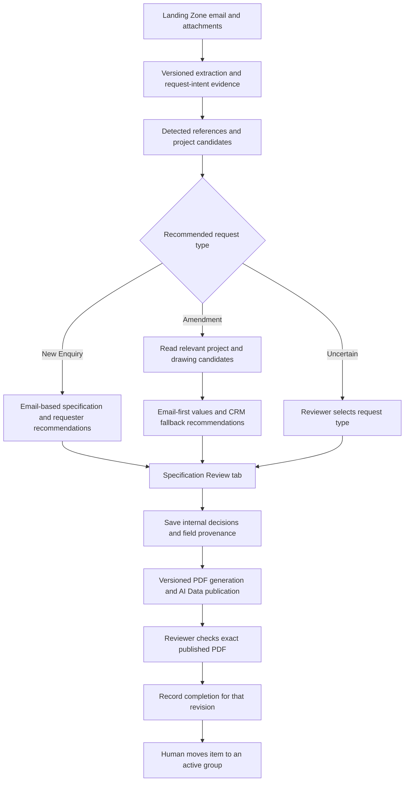

# Performance Specification Review implementation plan

Date: 9 November 2026

Status: proposed implementation; no application changes or production enablement are included in this document.

## 1. Intended result

Deliver a dedicated **Specification Review** Item View in Monday's **Projects Holding Page**. In deployment version 1, any authenticated Monday CRM user with access to the item can prepare, correct and complete its Performance Specification while the item is in **Landing Zone**. The reviewer checks the regenerated PDF before manually moving the item to an active group. Explicit specification-reviewer role/user authorization is deferred to deployment version 2.

The existing active-project chat serves the design team. The new reviewer view has its own entry point, permissions, API and state. It can share hosting and backend infrastructure without depending on active-group ingestion or chat.

Applying reviewer decisions writes internal review records and publishes the specification PDF to the holding item's AI Data file column. It does not write Accounts, Contact, TP Ref, New Enq / Amend, status, group membership, or specification values on shared project/drawing records. Appropriate users maintain those Monday business fields.

This is a multi-part feature, beyond the original change of publishing scope. It requires an additive database migration, source-policy changes, a review API, an embedded interface, publication changes, tests and staged deployment.

## 2. Accepted business rules

These decisions are requirements, rather than questions to reopen during implementation.

| Area | Agreed behaviour |
| --- | --- |
| Publishing scope | Landing Zone only; Completed Folder, active groups and archived/deleted items cannot receive new specification publications. |
| Reviewer interface | Dedicated Specification Review tab inside the Monday item; form input replaces the suggested Excel workflow. |
| Reviewer authorization | Deployment version 1 grants reviewer authorization to any authenticated Monday CRM user in the configured account with live access to the item; no assigned reviewer role or reviewer-user allowlist is required. Explicit specification-reviewer role/user authorization is deferred to deployment version 2. |
| Request type | AI recommends New Enquiry, Amendment or Uncertain. Email intent, detected references and project matches support the recommendation. The reviewer can correct it. |
| Lookup trigger | A reference detected in email context can trigger read-only project/drawing lookup. A populated holding-item TP Ref relation is not a prerequisite. |
| New Enquiry | Email context supplies specification recommendations. Company/Account and Contact are recommended from the selected client request. |
| New-enquiry drawing identity | Drawing Reference and Revision are intentionally unassigned until design is completed, unless explicitly specified by the reviewer. TP Ref is entered later by appropriate users. |
| Amendment Company/Account | Recommend the Account associated with the detected/matched project. Show any differing email company for reviewer reconciliation. |
| Amendment Contact | Email context first; Contact retrieved through the selected project/drawing is fallback. |
| Amendment field precedence | Populated email facts take precedence over existing CRM values. |
| Missing amendment technical details | Recommend existing CRM values when the email omits U-values, insulation, membrane, VCL or decking. |
| Other amendment recommendations | Company/Account, Drawing Reference, Revision and Surveyor receive project/drawing-backed recommendations. |
| Reviewer authority | Every PDF field can be overridden, including Incoming Information, Revision and an explicit blank. |
| Reviewer source label | An overridden field displays exactly **Source: Reviewer Specified** in the PDF. |
| Drawing format | Any two-letter alphabetic prefix is structurally valid; the numeric/version/revision suffix pattern is retained. Preserve the actual prefix. |
| Drawing selection | Prefer the relevant email reference, then offer the latest appropriate existing drawing as a reviewable fallback. Retain multiple plausible roof/drawing choices. |
| Revision | Describe the selected existing drawing; do not generate its future issued revision. An explicit reviewer override takes precedence over derivation. |
| Completion | Completion refers to the latest successfully published PDF reflecting current saved decisions and relevant sources. |
| Leaving Landing Zone | Stop specification refreshes and edits; retain the attached PDF and review history. Group moves remain human actions. |

Company/Account is the explicit amendment-specific reconciliation rule: the linked Account is a CRM-backed recommendation, not an instruction to silently replace a differing email company. A reviewer resolves the disagreement.

A project match is supporting evidence, not proof of an amendment. A familiar site or customer may still submit a new enquiry.

## 3. Scope and boundaries

### Included

- Landing Zone eligibility, discovery and cancellation fixes.
- Request-intent recommendation with cited supporting email context and project matches.
- Reference extraction and project resolution independent of the holding TP Ref relation.
- Generalized reference parsing and controlled latest-drawing recommendations.
- Reusable requester/directory matching where appropriate.
- Email-first source resolution and amendment CRM fallback.
- Persistent reviewer choices, all-field overrides, provenance and audit.
- Revision-specific approval and completion state.
- A dedicated embedded Monday reviewer form and authenticated PDF access.
- Existing publication recovery protections, diagnostics and rollout controls.

### Boundaries

- The review path has no Monday business-column or shared project/drawing mutation capability.
- The existing design-processing CSV, preview PDF and matched-project report continue to exist. Changes to their explanatory Reason for Change text must be explicit and tested.
- The existing design worker's own Date Received/hour/postcode behaviour is a separate workflow; reviewer saves must not start that worker or write those fields.
- No automatic group moves, automatic rollback of an early move, worker-written completion column, Account/Contact creation or Excel input.
- No new TRICS application integration is implied by producing a PDF. Exact accepted-value mapping must use an authoritative catalogue where needed.
- Existing active/completed specification PDFs are retained. Broad historical file cleanup is outside this release.

## 4. Current implementation and gaps

| Existing location | Current behaviour | Required change |
| --- | --- | --- |
| [app/config.py](app/config.py) | Specification flag defaults off; comment describes active-group-only publication. Pipeline is output-v17. | Document Landing Zone scope, add reviewer controls and version the new pipeline. |
| [app/services/performance_specification_sources.py](app/services/performance_specification_sources.py) | Active groups minus Landing Zone/Completed; populated CRM overwrites email; holding Accounts/date applied last. | Landing Zone policy and explicit email/recommendation/reviewer resolution. |
| [app/services/performance_specification.py](app/services/performance_specification.py) | Durable queue, leases, semantic revisions, upload recovery and owned-file cleanup. Discovery requires active Task state and only creates missing records. | Preserve recovery; include reviewer identity in publication inputs; repair discovery and cancelled-record recovery. |
| [app/services/monday_metadata.py](app/services/monday_metadata.py) | Cancelling metadata also cancels the specification. | Decouple cancellation; specification-owned lifecycle gates decide eligibility. |
| [app/routes/monday_webhooks.py](app/routes/monday_webhooks.py) | Queues specification work before auto-sync may cancel it. | Make Landing Zone queueing survive auto-sync exclusion; maintain dependency notifications. |
| [app/services/design_processing_reconciliation.py](app/services/design_processing_reconciliation.py) | Reconciles Landing Zone and registered eligible items. | Recover eligible specification work, including cancelled rows and new policy versions. |
| [app/services/legacy_enquiry/analysis.py](app/services/legacy_enquiry/analysis.py) | Reason for Change is forced to Reviewer decision required. | Add typed AI recommendation; retain distinction from a human Monday decision. |
| [app/services/legacy_enquiry/matching.py](app/services/legacy_enquiry/matching.py) | Title-based candidates and similarity, not request intent. | Reuse candidates; add direct-reference resolution and combine evidence. |
| [app/services/specification_semantics.py](app/services/specification_semantics.py) | TP/AX accepted; other two-letter prefixes are review-only. | Central parser accepts any two-letter prefix without a prefix-only warning. |
| [app/services/performance_specification_contract.py](app/services/performance_specification_contract.py) | Fixed CAD choices; Incoming Information must be blank. | Separate validated automated translation from authoritative reviewer PDF values. |
| [app/services/performance_specification_pdf.py](app/services/performance_specification_pdf.py) | Prints values/review notes; no field source display. | Print effective values and separate source labels, including Reviewer Specified. |
| [app/models.py](app/models.py) | Processing state/artifact ledger; no human decisions or approval. | Add durable review, event and approval entities. |
| [app/routes/tasks.py](app/routes/tasks.py) and [app/routes/monday_handoff.py](app/routes/monday_handoff.py) | Task access and managed handoff are coupled to ingestion. | Add a direct review API; do not reuse ingestion-triggering handoff unchanged. |
| [../frontend/monday_app/app.js](../frontend/monday_app/app.js) | Item View launcher opens the active-project app. | Keep that entry point; register a separate reviewer Item View. |
| [../frontend/main_app/app/tasks/[externalTaskKey]/page.tsx](../frontend/main_app/app/tasks/[externalTaskKey]/page.tsx) | Summary, sources and design-team chat. | Build the reviewer workspace on a separate route. |

### External logic already assessed

- [SalesBoardAutomation Account matching](https://github.com/SamuelOjuri/SalesBoardAutomation/blob/450120fd3a6b6f2fe9a45322d959545fdaf1be6b/backend/app/services/accounts.py#L144) and [requester identification](https://github.com/SamuelOjuri/SalesBoardAutomation/blob/450120fd3a6b6f2fe9a45322d959545fdaf1be6b/backend/app/services/requester_identity.py#L78) provide reusable identity concepts. Its Contact lookup only assists Account disambiguation; it is not a complete Contact reconciliation interface. Its Sales-board publication path must not be imported into this PDF-only workflow.
- [TechnicalDesignAssistant drawing selection](https://github.com/SamuelOjuri/TechnicalDesignAssistant/blob/1c736d497419deefefa7440b4301d1bb4e1e3c51/backend/app/services/monday_service.py#L96) implements exact-target selection followed by a project-wide version/revision fallback. Adapt the concept, rather than copying the all-archived fallback, single-letter parsing or old CRM-first merge.
- Existing pinned producer-source manifests describe legacy provenance. Preserve those manifests and ignored producer snapshots; version new runtime behaviour separately.

## 5. End-to-end architecture

Separate the following identities:

1. **Email/extraction identity:** current email/supplementary-source revision plus full extraction pipeline identity.
2. **Recommendation identity:** relevant source facts, candidate/selected project and drawing, CRM reads and source-policy version.
3. **Reviewer decision identity:** normalized saved decisions plus monotonically increasing review version.
4. **Artifact identity:** effective PDF values, provenance and the above identities plus publication/model/template versions.
5. **Approval identity:** the exact artifact, review version and source fingerprint accepted by an authenticated reviewer.

An older attachment or an extraction job's ready_for_review state is not evidence that the specification is complete.

## 6. Data contracts and migration

Use the existing PerformanceSpecification row as queue/publication state. Keep its review_json for processing diagnostics; the worker currently replaces that JSON during refreshes and failures, so it is unsuitable for durable human decisions.

Add an additive Alembic migration after 0018_specification_evidence. The proposed filename is 0019_specification_review.py; confirm the repository head before implementation.

### 6.1 Internal review record

Proposed table: **performance_specification_reviews**.

| Field | Purpose |
| --- | --- |
| board_id, item_id | Composite identity and FK to the specification record. |
| monday_account_id | Bind records to the verified tenant; validate against the configured board/account. |
| review_version | Monotonic version for meaningful saved decision changes. |
| schema_version | Version of the internal decision contract. |
| source_fingerprint | Source/recommendation identity the reviewer last saw. |
| selected_request_type | Internal reviewer selection: new_enquiry, amendment or unset. |
| selected_project_board_id / item_id | Internal project choice; never writes the holding TP Ref relation. |
| selected_drawing_board_id / item_id | Internal drawing choice. |
| field_decisions_json | Versioned decisions for the exact 18 PDF labels. |
| source_dispositions_json | Explicit acknowledgements or reviewed dispositions for source-level recommendations. |
| desired_publication_identity | Latest saved decision/source identity awaiting publication. |
| current_approval_id | Pointer to the current valid approval, cleared when relevant inputs change. |
| created_at, updated_at | Operational timestamps. |

Request-type proposals and automatic candidate snapshots remain separate from the reviewer's selections. Do not describe an AI recommendation as a human classification.

### 6.2 Immutable review events

Proposed table: **performance_specification_review_events**.

Store event UUID, account/board/item, actor app/Monday identity, command type, prior/resulting review version, original/replacement decisions, base source fingerprint, optional explanation, server timestamp, idempotency key and request digest.

Record field edits, intentional blanks, restoring recommendations, request-type/project/drawing selections, source reconfirmation and approval/invalidation events. Never store credentials in events.

Use a uniqueness constraint for actor/item/idempotency key. Reusing a key with a different request is a conflict; repeating an identical request returns the original result.

### 6.3 Immutable approvals

Proposed table: **performance_specification_approvals**.

Store approval UUID, exact artifact revision FK, board/item/account, review version, source fingerprint, extraction identity, decision digest, selected project/drawing IDs, actor and approval timestamp.

Preserve approval history. Invalidate current completion by clearing the review record's current pointer and appending an event; do not rewrite the historic approval into approval of a different PDF.

### 6.4 Field decision contract

Each field distinguishes these operations:

| Operation | Meaning |
| --- | --- |
| No decision | Use the current automatic proposal and display its actual source. |
| Accept recommendation | Snapshot the selected recommendation/value and provenance; record reviewer acceptance. |
| Specify value | Use the reviewer's value; display Reviewer Specified. |
| Specify blank | Use an intentional blank; suppress email/CRM fallback; display Reviewer Specified. |
| Restore recommendation | Remove the field override and recompute the automatic proposal. |

For a manual value, retain raw display text, optional validated CAD value, source label, actor/time, the reviewed source identity and optional explanation. Keep the original email facts and CRM recommendation in the audit.

Accepting an unchanged recommendation preserves Email Context or Monday CRM as its source, with reviewer acceptance recorded separately. Explicitly entering a value is Reviewer Specified even if its text equals the recommendation.

### 6.5 Artifact compatibility

New immutable artifact source_json must contain the review version, decision digest, recommendation fingerprint, source-policy/parser versions and field provenance. Add indexed columns only where needed for efficient approval/CAS checks.

Historic artifacts have no reviewer metadata and must not be backfilled as approved. Continue to serve retained historical PDFs according to item access.

## 7. Extraction, classification and project resolution

### 7.1 Request-intent recommendation

Add a typed sidecar contract, initially request-intent schema version 1:

- recommended type: new_enquiry, amendment or uncertain;
- explanation and supporting source IDs/excerpts/locations;
- detected project references and full drawing references;
- relevant matched-project IDs and matching rationale;
- ambiguity/conflict reasons.

Use the current selected external client request and its attachments. Recognize contextual amendment language, including requests to adjust/change an existing scheme, rather than relying on the literal word amendment. A quotation in an unrelated historical message must not control current classification.

Let exact detected references and the existing project matcher support the recommendation. Keep similarity scores separate from model intent assessment; do not present a project-name similarity percentage as a calibrated classification probability.

Maintain a usable uncertain result when evidence conflicts, several projects are plausible or sources are incomplete. The reviewer can select the request type without changing the Monday New Enq / Amend field.

Implement in proposed specification_intent.py, with integration in legacy_enquiry/analysis.py, parameter_extraction.py, llm.py and design_processing_pipeline._extraction_payload.

Keep the canonical CSV row count and 18 specification labels unchanged. Update the existing Reason for Change row to clearly identify an AI recommendation, such as Amendment (AI recommendation) or New Enquiry (AI recommendation); uncertain remains Reviewer decision required. Update its source label and matched-report explanation deliberately. This row is not the human-owned Monday classification column.

### 7.2 Direct reference lookup

Distinguish the printed project reference, full drawing reference and Monday item ID.

1. Extract relevant references from subject, selected client message, forwarded context and supported attachments.
2. Preserve literal source, scope, role, prefix and numeric components.
3. Resolve project-reference candidates against the configured project board using parameterized, read-only queries.
4. Combine exact-reference results with title-based project candidates.
5. Fetch relevant drawing/account recommendations for plausible candidates and show the match rationale.
6. Store reviewer selection internally.

Do not require holding Accounts, TP Ref or Date Received to be populated before rendering the review workspace or preparing an email-based PDF. Their current unconditional source prerequisites must be removed.

An existing holding TP Ref may be shown as context, but does not silently select a different project or override the detected evidence. A reference mentioned in a new enquiry may support classification/search without importing that project's specification into the New Enquiry branch.

Use bounded lookups, existing retry/rate-limit utilities and short-lived typed read caches. Paginate candidate inventories completely where necessary; do not treat a truncated first page as the whole project directory.

## 8. Generalized drawing references and latest recommendations

### 8.1 Shared parser

Introduce a single parser, for example specification_references.py, and use it from extraction, evidence checks, recovery, source selection and latest-drawing ranking.

The normal family is two alphabetic prefix characters followed by project digits, underscore, numeric drawing/version components and an existing revision suffix. For example:

    AB12345_26.01 - A
    CD12345_26.01 - AA

Compare case, whitespace and dash variants consistently while preserving the literal reference and leading zeros for display. Keep project identity and drawing/roof series separate.

A valid two-letter prefix must not generate a review warning solely because it differs from TP or AX. Prefix shape alone does not establish that the drawing belongs to the current request; retain evidence, issuer/context and project-association checks.

Do not collapse AB12345 and CD12345 into one identity simply by removing arbitrary prefixes. Resolve any legacy bare-number or D.S form only through the existing explicit provenance/CRM-confirmation paths; do not infer a new prefix.

Update all affected paths, including specification_semantics.py, performance_specification_evidence.py, specification_recovery.py, legacy_enquiry/parameter_extraction.py, legacy_enquiry/llm.py and performance_specification_sources.py. Remove prefix-only issue codes/messages and their stale special-case behaviour.

### 8.2 Updated field descriptions

**Drawing Reference:** The drawing reference number issued for a TaperedPlus project. Its usual format has a two-letter alphabetic prefix followed by the project number and drawing/version suffix, for example AB12345_26.01 - A. Preserve the actual prefix. Use the reference relevant to the current request; when several relevant versions are present, use the latest applicable existing version. If no suitable reference is found in email context, offer an appropriate existing CRM drawing for reviewer selection.

**Revision:** The complete suffix after the underscore in the selected Drawing Reference, for example 26.01 - A from AB12345_26.01 - A. It describes the selected existing drawing. Do not generate a future issued revision. An explicit reviewer value overrides automatic derivation.

### 8.3 Latest-drawing algorithm

1. Prefer a unique relevant email reference associated with the request.
2. Validate the referenced drawing's project, lifecycle and roof/drawing scope.
3. If the requested reference is historical, archived, unavailable or differs from the current version, display that condition and suitable existing alternatives.
4. Without a usable exact target, group plausible active drawings by their appropriate roof/drawing series.
5. Rank within each group using parsed integer components and proper multi-letter revision ordering: the sequence is Y, Z, AA, AB, and latest-first ranking reverses that order. Do not sort version strings as floats or select by Monday ID.
6. Propose the latest appropriate candidate in each plausible group.
7. If multiple groups remain plausible, show them to the reviewer instead of silently choosing an unrelated roof.
8. If all candidates are archived/deleted or unreadable, return an actionable review state; do not use the old highest-ID archived fallback.

Distinguish unavailable lookups from an empty valid result. Neither should invent a reference, issuer or future revision.

## 9. Field-by-field source policy

Treat email facts, CRM recommendations, reviewer decisions and final PDF values as separate objects. Refactor the current apply() path that overwrites email raw values with CRM.

A field result should expose email value/evidence, CRM candidates with exact record/column identities, recommendation rationale, saved reviewer decision, effective display value, optional CAD mapping, source, applicability and unresolved issues.

The 18 PDF labels remain:

| Field | New Enquiry automatic proposal | Amendment automatic proposal |
| --- | --- | --- |
| Scale | Relevant email/attachment evidence. | Email first; reviewer resolves absence. |
| Page Size | Relevant drawing/title-block evidence. | Email first; reviewer resolves absence. |
| Drawing Reference | Not yet assigned. | Relevant email reference first; controlled existing-drawing recommendation if needed. |
| Drawing Title | Email context. | Email context; show selected project title as context rather than silently replacing a populated request title. |
| Bauder Contract Number | Email context. | Email context; reviewer supplies missing information. |
| Bauder Roof Num | Explicit email/attachment roof identifier. | Same, used to scope recommendations. |
| Incoming Information | Blank. | Blank. |
| Revision | Not yet assigned. | Full suffix of the selected existing reference, with email/CRM discrepancies shown for review. |
| Date Received | Selected client's request date from email context. | Same; do not replace it with the old project's date or holding column. |
| Company | Email requester recommendation; optional directory matching identifies the canonical Account. | Recommend detected project's linked Account; show email company and disagreements. |
| Contact | Selected client requester from email context. | Email first; selected project's appropriate drawing/request Contact is fallback. |
| Surveyor | Email context or reviewer selection. | Email first; selected project/drawing CRM recommendation when needed. |
| Target U Value | Email requested target. | Email requested target first; existing CRM recommendation when omitted. |
| Target Min U Value | Email explicitly identified minimum/secondary target. | Email first; existing CRM recommendation when omitted. |
| Membrane | Email context. | Email first; existing CRM recommendation when omitted. |
| Tapered Insulation | Email context. | Email first; existing CRM recommendation when omitted. |
| VCL | Email context. | Email first; existing CRM recommendation when omitted. |
| Decking | Applicable roof evidence from email/attachments. | Email first; existing CRM recommendation when omitted. |

Reviewer Specified values override every row, including blank/default/derived entries. An intentional blank is not Not Provided and must not be repopulated by fallback.

Do not merge technical values from several candidate roofs into one specification. Preserve separate scoped candidates until selection, or show a review issue.

### 9.1 Identity reconciliation

For New Enquiries, derive Company/Contact recommendations from the selected email request. Directory matching can resolve exact existing identities without importing a previous project's specification.

For Amendments, use the detected/selected project's Account recommendation. Resolve Contact from the current email first, then from the selected drawing/request under that project. Avoid project-wide Contact mirrors that aggregate several unrelated contacts unless an explicitly configured, readable requester source is available.

Adapt the pure matching concepts from SalesBoardAutomation. Exclude its Sales-board mutation client. Do not imply that its current pipeline already finds and publishes every Contact.

### 9.2 Recommendation visibility

The initial PDF may contain clearly labelled provisional CRM recommendations and review notes. Accepting a recommendation snapshots the actual reviewed value; it must not silently follow later CRM changes.

Field review issues can be resolved by an authenticated reviewer supplying an authoritative value. Human values do not need fabricated email excerpts. Source-level unread-file problems require an explicit reviewed disposition or remain visible; an unrelated field edit must not silently erase them.

Compute required CRM dependencies after considering saved decisions. An unreadable optional CRM recommendation must not block publication of a field already superseded by an authoritative Reviewer Specified value. Record the lookup failure separately, retain required live item/input identity checks and continue to surface unresolved source-level issues.

## 10. Publication contract, source labels and PDF layout

Preserve the existing durable artifact ledger, integrity checks, deterministic filenames, upload adoption and owned-file cleanup.

Separate:

- automated CAD translation and its strict allowed choices;
- effective reviewer-authored PDF display values;
- field provenance and review diagnostics.

Every field must accept a reviewer display value, including Incoming Information and manual Revision. For standard values, retain numeric/date/format checks and selectable CAD suggestions. For a reviewer-specified custom value that has no permitted CAD mapping, preserve the exact PDF text and mark mapping status; do not silently replace or discard it. Completion must explain any mapping limitation the reviewer needs to acknowledge.

Render provenance separately from the value:

    Decking: Timber (18mm)
    Source: Reviewer Specified

Source metadata must not become part of the extracted CAD value. Keep the 18 labels/order and selectable PDF text; update downstream extraction fixtures to verify that source lines are ignored as values.

Show sources such as Email Context, Monday CRM recommendation and Reviewer Specified. Include reviewer/time attribution in internal audit, with a compact document-level review/version indicator where useful.

Build the artifact digest from effective values, field provenance, relevant source/extraction identity, chosen project/drawing, meaningful review version/decision digest, source-policy/parser versions and publication/model/template versions. Exclude polling timestamps, unrelated CRM fields, approval events and transport metadata.

A meaningful saved field/selection change increments review_version and generates a matching artifact. Identical normalized saves are no-ops. Approval itself does not generate another PDF.

Retain the existing model translation cache when inputs are unchanged. A reviewer edit with a valid final CAD choice should not require a new extraction call, and can bypass translation for that field. Reference/provenance-only changes should not cause unnecessary model work.

## 11. Reviewer API, identity and permissions

Add a proposed router app/routes/specification_review.py and services for review authorization, decisions, recommendation assembly and completion.

### 11.1 Monday embedding and authentication

Register a separate Monday Item View named Specification Review, targeting a dedicated frontend route.

**Deployment version 1:** Any authenticated Monday CRM user in the configured account who can read the item has specification-reviewer authorization. No specification-reviewer role assignment or reviewer-user allowlist is required. Editing and approval remain subject to feature enablement, operating mode/item allowlist, live Landing Zone eligibility and the other save/completion checks below.

**Deployment version 2:** Add an explicit account-scoped specification-reviewer role or approved-user check before granting edit/approve capabilities, and revalidate that authorization on mutations. No specific Monday CRM users have yet been assigned this role; assigning reviewers and enforcing this restriction are version 2 work.

Use SDK context and a sessionToken to bootstrap the view. Monday documents that this frontend/backend token is signed with the app's Client Secret and contains account/user identity; implement validation for the SDK token type, not the separate board-webhook signature type. See [monday.get](https://developer.monday.com/apps/docs/mondayget).

Proposed authentication flow:

1. The view sends the SDK token and item context to a review-specific bootstrap endpoint.
2. Backend verifies signature/expiry and derives account/user from trusted claims.
3. Resolve the matching server-side OAuth user link and verify live item readability with that user's access.
4. In version 1, grant reviewer authorization to the authenticated actor after verifying the configured account and live item access; do not require reviewer-role membership or a reviewer-user allowlist. Version 2 adds the explicit reviewer role/approved-user check for that account.
5. Validate actual board, item lifecycle and group against server settings, then derive capabilities. Eligible Landing Zone reviewers receive edit/approve capabilities; an authorized actor outside that scope can receive read-only retained-document access.
6. Issue a short-lived review-scoped bearer carrying those capabilities, held in browser memory and sent in headers.
7. Revalidate authenticated identity, account, item access and live scope for edits and approval; renew via SDK bootstrap when needed. Version 2 also revalidates the explicit reviewer role/approved-user authorization.

A signed account/user token does not by itself prove access to an arbitrary client-supplied item. The ingestion service token is for backend processing/publication, not proof of reviewer permission.

This flow avoids requiring third-party session cookies inside the Monday iframe. If a user OAuth connection is missing, use the established Monday-first OAuth utilities with a review-specific signed return context; open authorization through a supported top-level flow and resume the embedded view. Do not route through the active-ingestion handoff or task page.

Preserve CSRF checks for any cookie-authenticated alternative. Configure CORS and embedding origins explicitly, and keep credentials out of URLs, logs and persistent browser storage.

In version 1, authenticated design-team users with live item access receive reviewer capabilities under the same scope and operating controls as other Monday CRM users. An account-to-approved-reviewer-user mapping is a version 2 control. The operating item allowlist limits eligible items during rollout; it does not restrict reviewer identities in version 1. Read-only retained-document access remains available to authenticated users with item access outside the editable scope.

### 11.2 Proposed endpoints

Base path: /api/specification-review/items/{boardId}/{itemId}.

| Method/path | Purpose |
| --- | --- |
| POST /api/specification-review/session | Verify SDK context, establish review identity and capabilities. |
| GET base | Workspace with all fields, candidates, sources, review/source versions, queue state, latest PDF and approval. |
| PUT base/decisions | Atomic save of internal classification/selection/field operations; queue regeneration. |
| POST base/refresh | Refresh recommendations while retaining saved decisions. |
| GET base/candidates | Bounded candidate lookup when not included in the workspace payload. |
| GET base/status | Lightweight polling of source/decision/publication/completion identities. |
| GET base/pdf/{revision} | Authorized stream of private artifact or issuance of short-lived signed access. |
| POST base/approve | Complete review of an exact successfully published artifact. |

All mutation bodies carry expected review_version, expected source fingerprint and an idempotency key. Derive the actor and source labels server-side.

Use stable errors: authorization_expired, reviewer_forbidden, source_waiting, source_unavailable, candidates_ambiguous, stale_review, source_changed, scope_changed and publication_failed. Return 409 for stale decision/source/artifact identities, 403 for permission failures and an appropriate pending response for asynchronous work.

Opening a review may report waiting for extraction or queue eligible design reconciliation explicitly. It must not require a Task, TaskSnapshot, active auto-sync state or chat ingestion. A GET must not silently backfill every old item.

### 11.3 Save transaction

Perform remote access/scope checks before a short DB transaction. Within the transaction:

1. Lock the review/specification rows in a consistent order.
2. Check expected review/source identity and idempotency.
3. Validate operations and resolve the normalized decision state.
4. Append an immutable event and update review_version for a meaningful change.
5. Clear current completion.
6. Increment specification generation and queue work.
7. Commit once.

Perform no Monday/model/storage network call while holding database row locks. A late worker checks both queue generation and the decision/source identity before promoting an artifact.

## 12. Completion, stale sources and lifecycle

Keep human-review state separate from processing state. Suggested presentation:

| Condition | Reviewer-facing state |
| --- | --- |
| Current extraction unavailable | Waiting for source analysis |
| Proposal ready or business choices outstanding | Needs review |
| Saved decisions await PDF | Regenerating PDF |
| Current decision/source identity published | Awaiting final review |
| Exact current PDF approved | Complete |
| Relevant source changed after review | Review required again |
| Processing or publication failed | Update failed; previous PDF available |
| Item outside Landing Zone | Read-only; retained PDF available |

Approval must check:

- authenticated Monday CRM user with live item access under the version 1 policy, plus explicit reviewer authorization in version 2, and a current live Landing Zone item;
- current extraction/policy identity;
- selected request type and required project/drawing decisions;
- addressed field recommendations or explicit reviewer values;
- latest saved decisions reflected in the current published artifact;
- verified artifact/asset identity and no newer queued/running generation.

Compare exact artifact revision, review_version, decision digest and source fingerprint. Reject approval of a superseded PDF. Use a fresh source read followed by a locked identity check; subsequent external changes are handled by webhook/reconciliation invalidation, since Monday and Postgres cannot share an atomic transaction.

Do not equate review_json being empty with approval: it can contain legitimate request constraints and source notes.

New input or relevant CRM changes retain saved overrides and audit history, reopen completion and flag decisions that need reconfirmation. Do not silently apply old accepted recommendations to a different roof or request type. Show the previous decision next to the new context.

Leaving Landing Zone cancels leases/queued work and makes the form read-only without deleting the attached PDF. An early human move produces an internal diagnostic; the app does not move the item back. Re-entry triggers a fresh eligibility/source check and reopens review as appropriate.

## 13. Landing Zone queue, discovery and webhook changes

### 13.1 Shared specification policy

Introduce specification-specific eligibility, for example specification_policy.py.

- Reuse design_processing_board_id and design_processing_landing_group_id as the single board/group configuration.
- Completed Folder exclusion takes precedence even under conflicting configuration.
- Require live active item lifecycle.
- Use the same policy for enqueue, source reads, save/approve, pre/post upload and cleanup.
- Rename active_specification_group_ids and update comments/errors.

Do not add Landing Zone to auto-sync's active groups; its excluded state is intentional for that separate process.

### 13.2 Cancellation regression

Remove cancel_specification from monday_metadata.cancel_metadata. Keep explicit specification cancellation for out-of-scope, archived/deleted, Completed and retirement paths.

Add an integrated regression proving that a Landing Zone webhook followed by auto-sync exclusion leaves eligible specification work queued.

### 13.3 Discovery and recovery

Stop filtering specification discovery on Task.auto_sync_state == active. Prefer registered DesignProcessingItem records and durable group observations, with a fresh live scope read before work. No Task row should be required.

If existing reconciliation observations cannot efficiently identify Landing Zone candidates, add a small indexed scope/check observation to the specification record rather than repeatedly scanning all historical design rows.

Discovery/reconciliation must:

- create missing eligible specification records;
- revive eligible cancelled records with scheduled_for unset;
- refresh records with obsolete source/publication policy;
- respect activation boundary, explicit backfill, operating mode and item allowlist;
- rotate fairly through a bounded due set;
- avoid continually requeueing settled or excluded items.

Discovery is periodic, not just startup. Repeated reconcile notifications must not increment generations or postpone work unnecessarily.

### 13.4 Dependencies and meaningful changes

Index dependencies on detected/selected projects, drawings and the relevant Account/Contact/mirror-source records even when the holding TP Ref is empty. Cover new subitem events through the parent project dependency.

Subscribe source-board field/lifecycle changes. Remove obsolete dependencies when selections change. Use conservative dependencies for current candidate choices, then narrow on selection. Missing webhooks are repaired by periodic checks.

Ignore generated AI Data/matched-output column changes to avoid feedback loops. A reviewer decision save queues specification publication directly; it does not simulate a Monday column change.

### 13.5 Initial queue timing and date race

The revised Date Received policy uses email context. Remove the unconditional holding-date override and exclude ignored holding-item Date Received/Accounts edits from semantic inputs. Relevant changes to the selected CRM Account remain recommendation/dependency inputs.

Retain a trigger after durable extraction so initial review and shadow rendering do not depend on publication of unrelated legacy artifacts. A later design scalar write may wake a webhook, but unchanged semantic inputs must reuse the same translation/PDF.

If an implementation introduces an actual dependency on design-published state, add an identity-based readiness gate and a coalesced post-publication wakeup. Do not solve readiness by moving the sole trigger after design publication, which would starve shadow and recovery paths.

## 14. Dedicated reviewer frontend

Proposed files:

- ../frontend/main_app/app/specification-review/page.tsx
- ../frontend/main_app/components/specification-review/ReviewWorkspace.tsx
- FieldEditor.tsx, CandidateSelector.tsx, PdfPreview.tsx and ReviewStatus.tsx in the same component directory
- ../frontend/main_app/lib/specification-review-api.ts
- ../frontend/main_app/lib/specification-review-state.ts

The separate route is hosted by the existing frontend but opens as the reviewer Item View inside Monday. It must not require the /tasks chat page or its ingestion/snapshot state.

Workspace layout:

1. Item identity, source freshness and request-type recommendation with rationale.
2. Internal request-type and project/drawing selection controls.
3. Relevant project/roof/drawing candidate cards and evidence.
4. All 18 fields, showing email value, CRM recommendation, current effective value, source, issue and edit controls.
5. Current PDF preview/download with revision and publication state.
6. Save corrections and regenerate PDF, followed by Mark specification complete.
7. Compact history of saved decisions and prior completion.

Support Use recommendation, Specify value, Specify blank and Restore recommendation as distinct actions. Preserve draft input during expiry, API failures or concurrent-edit conflicts; never silently overwrite unsaved text when polling.

Disable completion while edits are unsaved or a matching PDF is pending/failed. Show business-facing states and actionable errors, rather than internal queue/model identifiers.

Listen for Monday item-context changes; abort old requests, clear item-bound credentials/state and bootstrap the new item. Maintain keyboard access, labelled errors, visible focus and usable narrow iframe layout.

Check frontend/main_app/proxy.ts: its current Supabase session-refresh path runs broadly. The dedicated reviewer route must bootstrap through its intended Monday auth flow without an active-chat login dependency.

Register the new Item View and embedding URL separately from the existing launcher. Verify actual frame-ancestor/CSP configuration, allowed origins, PDF preview behaviour and authorization in the target browser. Monday supports hosted client views or iframe URLs; see its [Views guide](https://developer.monday.com/apps/docs/quickstart-view).

## 15. Versioning, configuration and TRICS mapping

### Version changes

Current inspected versions are output-v17, performance-specification-v4 and evidence version 2. Reserve output-v18 and performance-specification-v5 for this implementation, subject to intervening repository changes.

Add request-intent schema version 1 and a source-policy/parser version. Advance the evidence version when its structure/acceptance semantics change.

Update the hardcoded specificationEvidenceVersion in design_processing_pipeline._extraction_payload to use the shared version constant. A changed constant alone is insufficient.

Require fresh matching extraction for the new policy; do not relabel old extraction as current. Historical PDFs remain available until a verified replacement succeeds.

### Proposed settings

| Setting | Purpose |
| --- | --- |
| PERFORMANCE_SPECIFICATION_ENABLED | Master specification processing control; `true` is required for rendering even in shadow, publication and approval. Reviewer saves may remain pending while it is false. |
| PERFORMANCE_SPECIFICATION_MODE | Independent specification `off`, `shadow`, `allowlist` or `enabled` mode; defaults to `off` and never inherits the design mode. |
| PERFORMANCE_SPECIFICATION_ALLOWLIST_ITEM_IDS | Specification-only positive Monday item IDs as CSV or a JSON array; defaults to `[]` and must be nonempty for specification `allowlist` mode. |
| PERFORMANCE_SPECIFICATION_REVIEW_ENABLED | New reviewer feature/mutation control; default false. |
| PERFORMANCE_SPECIFICATION_REVIEWER_USER_IDS_BY_ACCOUNT | Version 2 only: explicit account-scoped approved reviewer users. This setting is not required or enforced in version 1. |
| PERFORMANCE_SPECIFICATION_REVIEW_SESSION_TTL_SECONDS | Short-lived embedded reviewer session lifetime. |
| PERFORMANCE_SPECIFICATION_REVIEW_MONDAY_ACCOUNT_ID | Optional deployment account pin; configured board and live user OAuth account/item access are always verified. |
| Existing DESIGN_PROCESSING_MODE / DESIGN_PROCESSING_ALLOWLIST_ITEM_IDS | Independent design extraction/CSV/preview/matched-report policy. May remain `enabled` during specification shadow or allowlist rollout. |
| Existing board/Landing Zone/project IDs | Shared canonical scope configuration. |
| Existing PERFORMANCE_SPECIFICATION_COLUMN_MAP | Exact readable CRM field mapping. |
| New versioned TRICS catalogue/mapping configuration | Accepted target identities/values where required. |

Keep specification settings consistent across the review API, specification publisher and design/reconciliation processes that enqueue specification work. Restart all affected processes after a mode/allowlist change; do not leave old publishers running with the former policy. Do not introduce a second independently configurable Landing Zone group. The existing `AUTO_SYNC_*` controls continue to govern document/chat ingestion independently.

For `PERFORMANCE_SPECIFICATION_MODE=off`, reviewer access is read-only and specification processing is stopped. With the master processing flag true, `shadow` permits private rendering; with review enabled it also permits edits, but no Monday publication or completion. Specification `allowlist` restricts processing, edits and approval to its listed eligible items; `enabled` includes all otherwise eligible items. If the master processing flag is false, permitted saves can remain pending but no rendering/publication/approval occurs. Review enablement does not start a worker or provision webhooks.

The new mode defaults to `off` on upgrade even when `PERFORMANCE_SPECIFICATION_ENABLED=true` and `DESIGN_PROCESSING_MODE=enabled` were already configured. Operators must deliberately set the specification mode and its own allowlist; a design-mode value or design allowlist cannot enable specification work.

### TRICS dependency

The current contract has fixed choices for Scale, Page Size, Membrane, Insulation, VCL and Decking. It does not contain a live TRICS catalogue for Company, Contact, Surveyor, Drawing Reference or Revision.

Before end-to-end target validation, obtain/version the authoritative accepted-value list or supported lookup source. Store Monday identity separately from display text and optional TRICS identity. Do not invent a TRICS ID or claim an unmapped reviewer value is machine-compatible.

The reviewer can still specify the PDF display value; mapping status must be explicit. This is an integration input, not a reason to reopen the agreed workflow.

## 16. Implementation phases and dependencies

Each phase ends with a reviewable change and its focused verification.

| Phase | Main work | Depends on | Exit evidence |
| --- | --- | --- | --- |
| Phase 1: Contract and fixtures | Encode the rules above; add representative New Enquiry/Amendment fixtures and source/decision schemas. | None | Field-policy matrix and expected outputs agreed in tests. |
| Phase 2: Review persistence | Add review/events/approvals, migration, CAS/idempotency services and artifact metadata. | Phase 1 | Migration round trip and PostgreSQL concurrency tests. |
| Phase 3: References and intent | General parser, intent sidecar, direct project resolution and latest candidates. | Phase 1 | Reference/classification/candidate tests pass. |
| Phase 4: Source policy and PDF | Email-first resolver, amendment fallback, all-field overrides, provenance and publication identity. | Phases 1, 2 and 3 | PDF text/provenance and no-business-write tests pass. |
| Phase 5: Landing Zone lifecycle | Eligibility, metadata decoupling, discovery/recovery and dependency webhooks. | Phases 3 and 4 | Integrated cancellation/discovery/lifecycle regressions pass. |
| Phase 6: Review API/auth | Direct review workspace, secure embedded identity with version 1 reviewer authorization, saves, PDF access and exact approval. | Phases 2, 4 and 5 | Version 1 authentication/item-access, stale-write and approval tests pass. |
| Phase 7: Monday reviewer view | Dedicated route, SDK context, editors, candidates, preview and status. | Phase 1; finish against Phase 6 | Mocked browser journeys and accessibility checks pass. |
| Phase 8: Integrated release | Complete end-to-end tests, runbooks, diagnostics and staged rollout. | Phases 2 through 7 | Allowlisted New Enquiry and Amendment completed successfully. |

Phases 2 and 3 can proceed in parallel after Phase 1. Phase 7 can start with a mocked API contract while backend work proceeds. Combine integration work only after shared schemas are stable.

Phase 6 and the initial Phase 8 release implement deployment version 1 authorization from section 11.1. Explicit specification-reviewer role/user authorization is deferred to deployment version 2; it is not an exit requirement for these phases.

## 17. Test and acceptance plan

### 17.1 Source and classification

- Existing customer/site match with genuinely new work remains a New Enquiry recommendation.
- Amendment language with subject/body/attachment reference supports Amendment.
- Amendment without an explicit reference can use candidate project matching.
- Uncertain/conflicting intent remains reviewable; no forced classification from similarity alone.
- Detected reference triggers lookup with an empty holding TP Ref relation.
- New Enquiry does not import old project technical fields.
- Email amendment values survive conflicting older CRM values.
- Missing amendment U-values, insulation, membrane, VCL and decking produce CRM recommendations.
- Contact uses current email, then appropriate CRM fallback.
- Company/project Account disagreement is visible.
- Holding Accounts/date/TP Ref changes do not silently override email/reviewer authority.
- Unrelated CRM changes do not alter semantic revision.

### 17.2 References and selection

- TP, AX, AB, CD and other alphabetic prefixes; mixed case and spacing/dash variants.
- Leading zeros and actual prefix retained.
- Different prefixes are not accidentally aliased.
- Full suffix retained for Revision; multi-letter revisions ordered correctly.
- Exact relevant email target wins over a general fallback.
- Several roofs/series remain visible; no silent cross-roof value merge.
- Archived/deleted/all-archived and unavailable-source cases.
- No invented future revision or prefix.
- Existing explicit legacy reference handling remains evidence-gated.

### 17.3 Reviewer decisions and PDF

- Parameterize across all 18 fields, including Incoming Information and Revision.
- Reviewer value, intentional blank, accepting a recommendation and restoring defaults.
- Exact Reviewer Specified source label appears separately from the value.
- Reviewer edits survive retries, refreshes and regeneration.
- Custom reviewer display text is preserved when CAD mapping is absent.
- An unreadable optional CRM recommendation does not block a field superseded by Reviewer Specified input; required live item/input identity checks still apply.
- Old email evidence and CRM suggestions remain in audit; no fabricated email citation is required for a human decision.
- New-enquiry unassigned reference/revision permits completion unless a reviewer specifies them.
- Relevant source change retains decisions but invalidates current completion.
- PDF text remains selectable; label/order/source separation works with downstream parsing.
- Long field values, long names, non-ASCII characters and multi-page layout remain readable.

### 17.4 Queue, lifecycle and publication

- Landing Zone webhook then auto-sync exclusion leaves specification queued.
- Discovery works without a Task and revives cancelled eligible rows.
- Leaving Landing Zone, Completed, archive/delete and return-to-Landing Zone behaviour.
- An ignored design Date Received write produces no extra translation/PDF revision.
- Shadow renders privately; allowlist gates claims, mutations and publication.
- Source/decision changes during translation/upload cannot promote stale outputs.
- Interrupted upload adoption, duplicate matches, integrity failure and cleanup retry remain covered.
- Failed replacement retains the previous PDF while current review remains incomplete.
- Prior specification cleanup deletes only ledger-owned superseded specification files.

### 17.5 API, permissions and concurrency

- Review opens without active ingestion or a completed TaskSnapshot.
- SDK identity, user OAuth link and item/board/account isolation are verified.
- In version 1, any authenticated Monday CRM user with live item access can save and approve an otherwise eligible specification without a reviewer role or reviewer-user allowlist, including when no reviewer IDs are configured. Feature enablement, operating mode/item allowlist and all save/completion checks still apply.
- An authenticated post-move user with item access can open the retained PDF in read-only mode; save and approve remain unavailable outside Landing Zone.
- Forged context, expired session, wrong account and lost item access fail correctly in version 1.
- Version 2 adds tests that users without explicit reviewer authorization cannot save or approve, and that reviewer-role/approved-user changes revoke those capabilities. These tests are deferred from the version 1 exit criteria.
- Identical command retries do not duplicate events, generations or uploads.
- Reused idempotency key with a different body fails.
- Concurrent reviewers receive a 409 instead of silent last-writer wins.
- Approval requires exact current artifact/source/decision identity and fails during newer queued work.
- Every correction path performs zero Monday business-column/project/drawing mutations.

Run PostgreSQL tests for locking, uniqueness, transaction and competing-worker guarantees. SQLite unit tests alone do not establish those behaviours.

### 17.6 Frontend journeys

Use mocked Monday SDK/API for local browser tests, then an explicitly allowlisted deployed check.

Cover New Enquiry without TP Ref, Amendment from detected reference, ambiguous candidates, all-field edits, regeneration failure, stale saves, source changes, session expiry, context switches, early group moves and approval of the final PDF.

Add test:specification-review helper tests and a small browser harness. The current frontend has task-polling/chat tests and build scripts, not an existing comprehensive review browser suite.

### 17.7 Existing checks and execution notes

After implementation, run focused new tests plus the affected existing specification, evidence, source, drawing, recovery, design-processing, metadata, webhook and Monday-first authentication suites.

The earlier repository assessment ran four offline specification suites with 314 passing tests. That is evidence for existing behaviour, not acceptance of this proposed feature.

Use existing commands where applicable:

    venv/Scripts/python.exe -m pytest backend/tests/test_performance_specification.py backend/tests/test_specification_drawing_selection.py backend/tests/test_specification_evidence.py backend/tests/test_specification_sources.py backend/tests/test_specification_publication_hardening.py backend/tests/test_specification_recovery_regressions.py backend/tests/test_specification_semantic_context.py -q

From frontend/main_app:

    npm run test:task-polling
    npm run test:chat
    npm run build

Add and run the new reviewer-specific test commands as part of Phases 6 and 7. New tests should verify business outcomes and failure boundaries, rather than repeat implementation details.

## 18. Rollout, backfill and rollback

1. Keep production specification publishing/review mutations disabled while implementing: `PERFORMANCE_SPECIFICATION_MODE=off`, `PERFORMANCE_SPECIFICATION_ENABLED=false` and `PERFORMANCE_SPECIFICATION_REVIEW_ENABLED=false`. Existing design outputs and auto-sync retain their independent settings.
2. Verify deployment board/column IDs, Monday authentication/OAuth scopes, source-board access, Item View configuration and TRICS catalogue inputs. Version 1 requires no reviewer IDs or reviewer-role assignments; verify those when deploying version 2.
3. Apply the additive migration before deploying code that uses it.
4. Deploy matching API, extraction, reconciliation and specification worker versions; drain old processes so old group/source/mode policies cannot continue running. Set the new specification mode explicitly: its default is `off`, independent of any existing design mode. Restart review API, publisher and specification enqueuers with matching specification settings.
5. Update the new Item View route/feature, CORS/embedding configuration and review authentication.
6. For staged private verification, set `PERFORMANCE_SPECIFICATION_ENABLED=true`, `PERFORMANCE_SPECIFICATION_MODE=shadow` and `PERFORMANCE_SPECIFICATION_REVIEW_ENABLED=true`. Run representative New Enquiries, explicit-reference Amendments, missing-reference Amendments and multi-roof projects. `DESIGN_PROCESSING_MODE=enabled` can remain in place for the existing CSV, preview PDF and matched-project report; `AUTO_SYNC_*` remains unchanged.
7. Review private PDFs, source labels, candidate choices and cost/latency. Shadow must not create completion against an unpublished artifact.
8. Set `PERFORMANCE_SPECIFICATION_MODE=allowlist` with a nonempty `PERFORMANCE_SPECIFICATION_ALLOWLIST_ITEM_IDS` CSV/JSON list of positive item IDs. Keep the specification master and review flags true, and restart the affected services with matching values. Only listed eligible items may process, edit, publish or approve specifications; the design allowlist is unrelated. In version 1, any authenticated Monday CRM user with access to those items can review them; no reviewer-user allowlist is required. Complete a New Enquiry and an Amendment through save, publish, final review and human group move. Add explicit reviewer authorization when deploying version 2.
9. Verify zero business-field mutations and inspect actual PDF source labels in Monday.
10. Expand the specification-only allowlist, then deliberately set `PERFORMANCE_SPECIFICATION_MODE=enabled` for activation-bounded eligible Landing Zone items after acceptance. Do not change the design mode or ingestion controls merely to expand specification review.
11. Backfill older Landing Zone items explicitly. Where extraction is missing/outdated, run item-scoped design reconciliation first; the specification CLI cannot create missing extraction by itself.
12. Keep existing active/completed PDFs and historical approvals/artifacts.

Rollback sets `PERFORMANCE_SPECIFICATION_MODE=off`, `PERFORMANCE_SPECIFICATION_REVIEW_ENABLED=false` and, to stop all specification processing, `PERFORMANCE_SPECIFICATION_ENABLED=false`, while retaining internal decisions and PDFs. Restart the affected review API/publisher/enqueue processes with matching values. Existing design processing and `AUTO_SYNC_*` ingestion settings remain independent. Keep schema additions in place under running services. Do not restart an older publisher against the new artifact contract or downgrade tables while new processes run.

If publishing is paused after a save, show the saved/pending state clearly and prevent completion until its matching PDF is actually published.

## 19. Diagnostics, documentation and completion criteria

### Operational diagnostics

Record account/board/item, source fingerprint, review version, decision digest, artifact revision, worker version and outcome. Track source waiting, recommendation failure, stale commands, superseded work, save-to-PDF latency, publication failures and invalidated approvals.

Keep email contents, model bodies, signed URLs and tokens out of routine logs. Use private source/audit records for authorized investigation.

Update diagnose_performance_specifications.sql for Landing Zone and the new review/approval fields. Prefer configured scope parameters or documented settings over additional hardcoded group lists. Include excluded Landing Zone tasks when present, but do not make a Task row a requirement for the report.

### Documentation

Update PerformanceSpecification.md, ExtractionWorker.md and MondayMetadata.md to reflect:

- Landing Zone-only publishing and independent cancellation.
- AI recommendation versus human Monday field ownership.
- Email-first policy and amendment CRM fallback.
- Generalized reference descriptions and latest-selection safeguards.
- PDF-only reviewer decisions and Reviewer Specified provenance.
- Direct embedded review access, version 1 authenticated-user permissions, version 2 reviewer-role authorization and exact-revision completion.
- Migration, versioning, mode/allowlist configuration, backfill and rollback.

Preserve the old producer provenance documentation while distinguishing the new runtime policy.

### Release completion criteria

The version 1 feature is complete when any authenticated Monday CRM user with live access to an eligible item can, from the Monday Specification Review tab:

1. Open an eligible Landing Zone item without active-group ingestion/chat.
2. Review/correct request type and candidate project/drawing selections.
3. See email-first values and appropriate amendment CRM recommendations.
4. Override any of the 18 PDF fields and see Reviewer Specified on the regenerated PDF.
5. Save safely under retries/concurrent edits without any Monday business-field write.
6. Check and complete the exact current published PDF.
7. Move the item manually into an active group with the completed document retained.
8. Receive a renewed review state when relevant inputs change while still in Landing Zone.

No further business clarification is required for this plan. Deployed app configuration, Monday authentication/item access and authoritative TRICS mapping data are implementation inputs to verify during version 1 setup. Assigned reviewer identities and explicit reviewer-role/approved-user authorization are version 2 implementation inputs.

